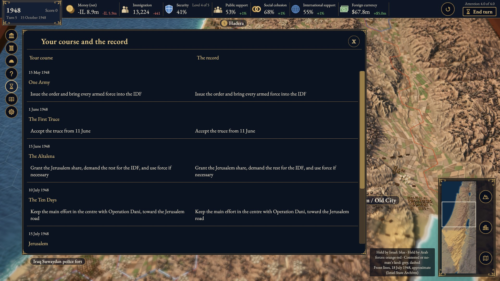
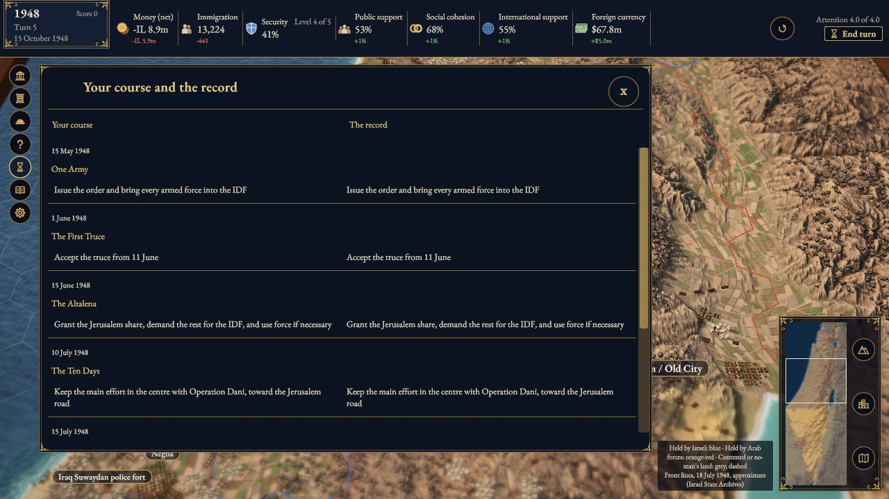
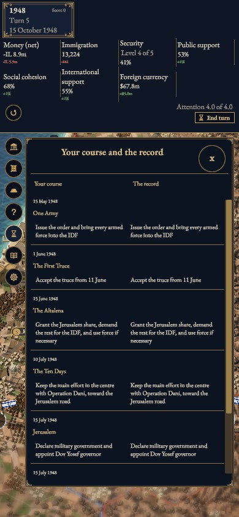
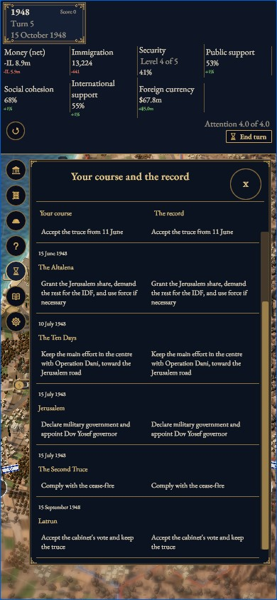
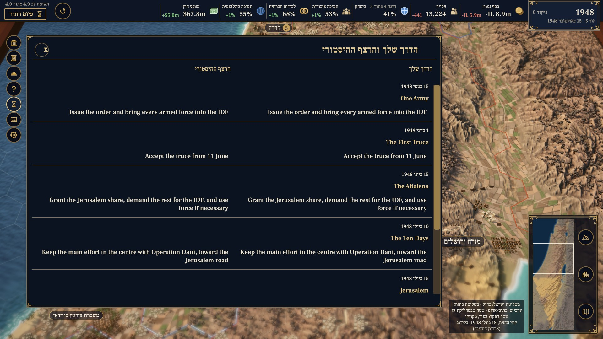
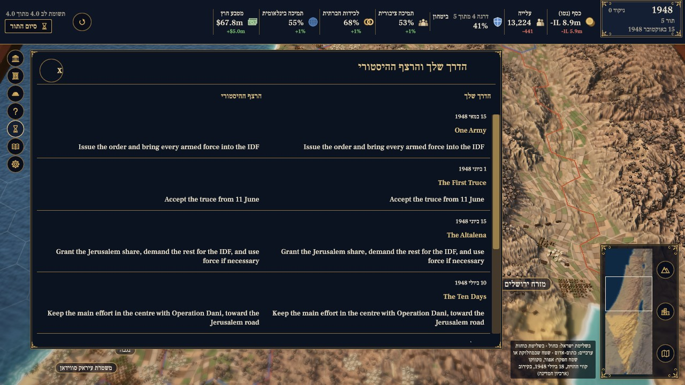
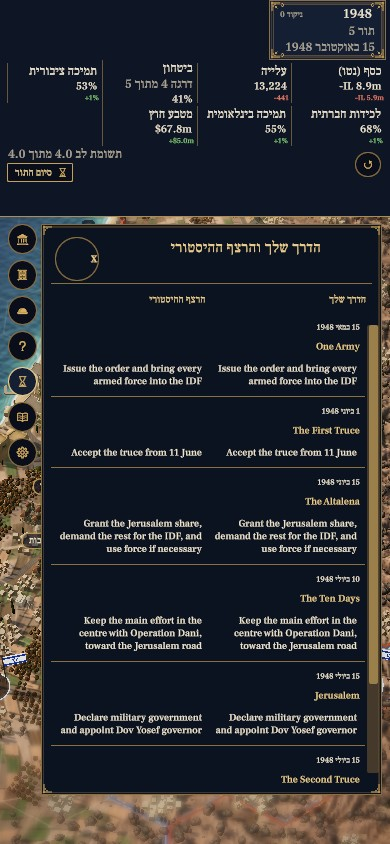
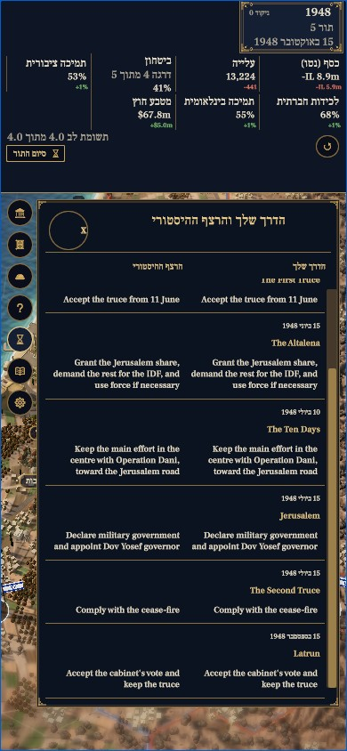

# Timeline screen capture evidence

Refs #955, #939. Actual WebGL screenshots captured at the UTC times in `captures.json` from source commit **c031a3989375322dd3a842b976a0c5ff638a26f5**, Unity 6000.3.25f1 `Build.Web -compression disabled`. This branch carries evidence only; product tests belong to that source commit, not to this evidence commit. Product-code byte identity is recorded in `captures.json`.

The isolated-profile Chrome runs use real game input and the built game, with no game-state injection. Each page independently awaits all eight current manifest goldens and the five-turn UI smoke line. The Timeline opens from its HUD button, End and Home are exercised; the inspected top/end images and actual navigation outcomes are recorded in `captures.json`. Keyboard focus/order/close/readonly-state/save/queue/session/language and paired-column layouts are separately covered by real UIToolkit EditMode tests. These images are agent-inspected; native Hebrew and human visual acceptance remain pending. Existing event text retains its English fallback (#55). Safari, VoiceOver, physical touch and operating-system screen-reader checks are separate.

Native PNG and JPEG are separate `Page.captureScreenshot` calls. No pixel editing, crop, annotation or generated mockup. Full raw console, PNG originals and command/exit/source records remain in the local evidence archive. This fork evidence branch publishes a bounded selection of unedited JPEGs and their per-file hashes.

## Attribution and licence

Credit **Statecraft: Israel contributors**. Captures are **CC BY-SA 4.0**, carrying forward the most restrictive visible input: the derived map bakes are CC BY-SA 4.0 under the owner’s D13 ruling. This does not describe D13 as a separate screenshot-specific approval. Existing visible Collection models retain the Tal Heuberger / Tripo Studio / CC0 disclosure; fonts retain EB Garamond and Frank Ruhl Libre OFL credits. See [ASSETS.yaml](../../../ASSETS.yaml), [LICENSING.md](../../../LICENSING.md) and [NOTICE](../../../NOTICE) for inherited records. Capturing the game does not independently verify historical claims or change any human source-review flag.

Required Copernicus notice:

> produced using Copernicus WorldDEM-30 (c) DLR e.V. 2010-2014 and (c) Airbus Defence and Space GmbH 2014-2018 provided under COPERNICUS by the European Union and ESA; all rights reserved

## Results and selected views

Exact source: `c031a3989375322dd3a842b976a0c5ff638a26f5` (base `2d3e13c0`). Managed checks: 305 policy, 1,967 simulation and 1,434 tools tests; four tools skips and two subtests. Full EditMode: 1,611 total, 1,609 passed, zero failed, two Explicit skips, zero inconclusive and zero C# warnings/errors. Build.Web completed in 612.522 seconds. Both languages pass all eight source golden values and smoke5 with the candidate’s own checker and zero failure patterns in the full logs. All six capture pages confirmed two actual Timeline openings around Escape. The phone End views visibly reach the final Latrun row.

The phone body typography is compact, following the existing screen style; human native/visual and text-zoom acceptance remain pending. No event photo or portrait is visible in this selection; existing terrain, models and map labels remain visible. No human source attestation is added.

