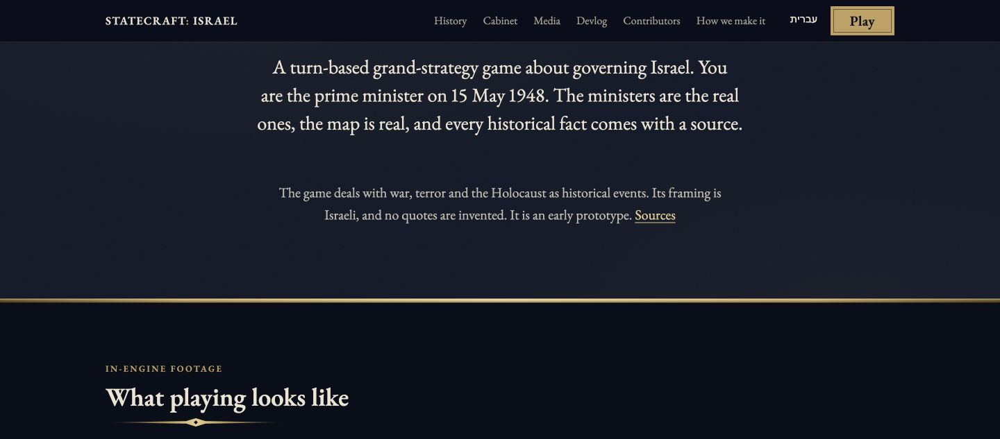
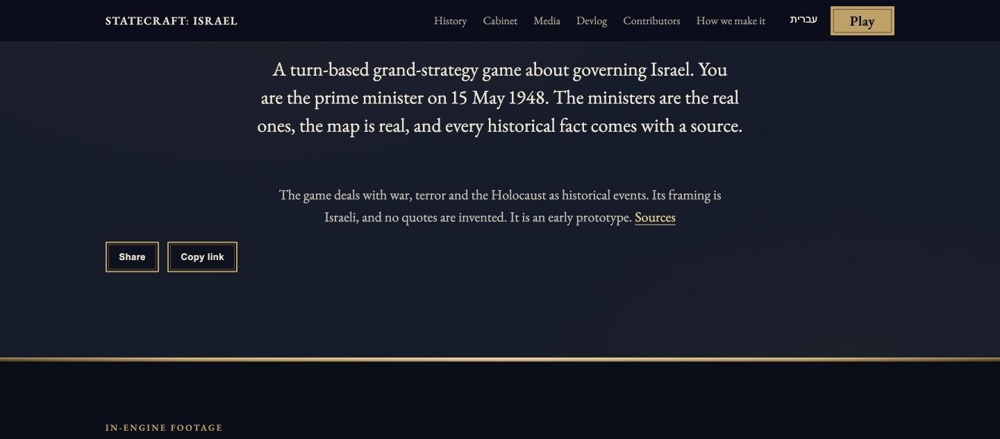
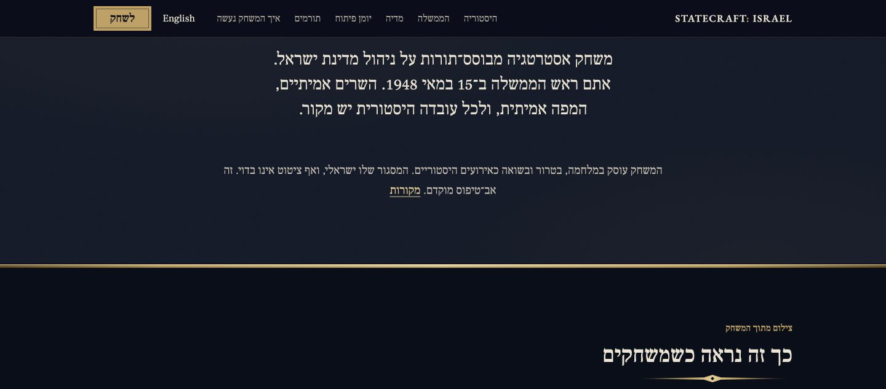
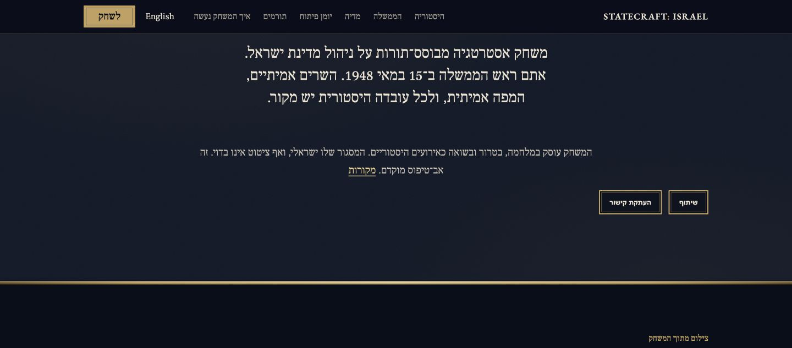
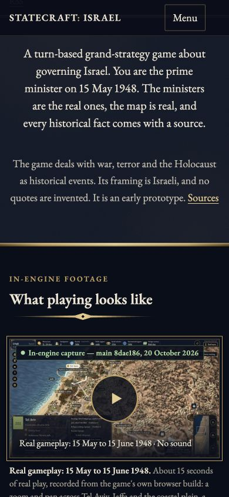
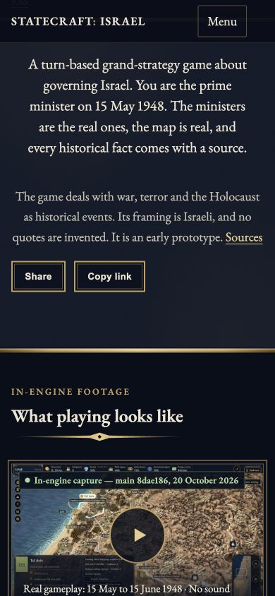
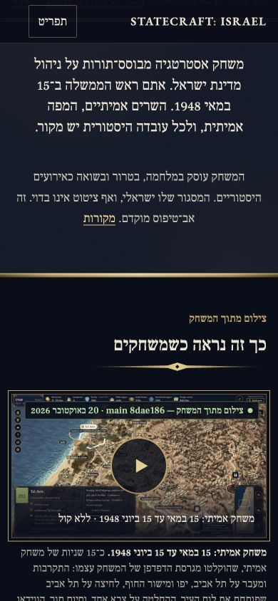
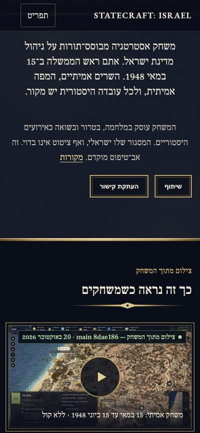

# Website sharing: original before/after review captures (#1038)

Changed area: the native Share and explicit Copy link controls beneath Sources in the home-page explanation. EN controls align left and HE controls align right. Buttons are 44 CSS pixels high. No image pixels were edited.

AFTER source: `9587f8505f06b7f2f9420f569065e0acbfcf112b`, tree `886533d51ca7f8687eac81e7ad9339279cc2f24a`.
BEFORE source: parent `178369faba9cd22f2058fb4108b4836ba78e996e`, isolated projected tree `5bce689e4459d4243a0d7c473d1f86ddbd9d65cf`.
Both are actual normal Astro builds, not a drawn mockup. Source and feature PR management remain with the Mac Air; this branch is review evidence only and must not be merged into the product PR.

Each pair uses the same language, viewport and `#what` section anchor. Desktop pairs are 1440x633; mobile pairs are 390x844 CSS pixels and are browser-viewport checks, not physical-device QA. Final EN desktop anchor is 3px lower than baseline, recorded rather than represented as pixel-identical. Added controls naturally move following content down; the existing gameplay poster below the section is visible in mobile pairs. Initial mismatched framing trials were excluded, not relabelled as accepted.

## Desktop English (1440x633)

| Before: controls absent | After: Share and Copy beneath Sources |
|---|---|
|  |  |

## Desktop Hebrew (1440x633)

| Before: controls absent | After: Share and Copy beneath Sources |
|---|---|
|  |  |

## Mobile English (390x844)

| Before: controls absent | After: Share and Copy beneath Sources |
|---|---|
|  |  |

## Mobile Hebrew (390x844)

| Before: controls absent | After: Share and Copy beneath Sources |
|---|---|
|  |  |

## Evidence and remaining gates

[Provenance and original SHA-256 values](provenance.json). [Bounded validation results](validation.txt).
These captures show public game-site content only: no browser profile, OS chooser, recipient, clipboard or private path. They establish the visible layout only. Two remaining real clipboard combinations and real permission-denial/manual fallback are still pending, as is final Air review. Hebrew is agent-checked, pending a person. No personal licence checkbox or historical/human-review attestation is supplied.

CONTRIBUTING.md prefers GitHub attachments. The browser upload requested broader local-file access; after explicit human approval, the tool still rejected the extension-settings URL under its security policy. No permission was changed and no bypass was attempted. This public fork evidence branch uses existing GitHub authentication and immutable commit links as a documented alternative. It is not a claim that an attachment upload succeeded.

## Attribution and licensing

Original captures by Codex on the MacBook Pro; credit **Statecraft: Israel contributors**. CC BY-SA 4.0, following the most restrictive visible input: the mobile gameplay poster is the existing `docs/images/build-m3-city.jpg` (main8dae186, not a new gameplay recording), registered as CC BY-SA 4.0 in ASSETS.yaml. Website text is CC BY 4.0. Existing font notices (EB Garamond/Frank Ruhl Libre, OFL) remain in `site/public/fonts/`. Existing AI-made models in the poster: Tal Heuberger, The 1948 Collection; these are not AI-generated screenshots. Provenance remains **owner-verify**, without a new rights or release sign-off. See the existing LICENSING.md, ASSETS.yaml and NOTICE at the pinned source.

Terrain notice: produced using Copernicus WorldDEM-30 (c) DLR e.V. 2010-2014 and (c) Airbus Defence and Space GmbH 2014-2018 provided under COPERNICUS by the European Union and ESA; all rights reserved.
