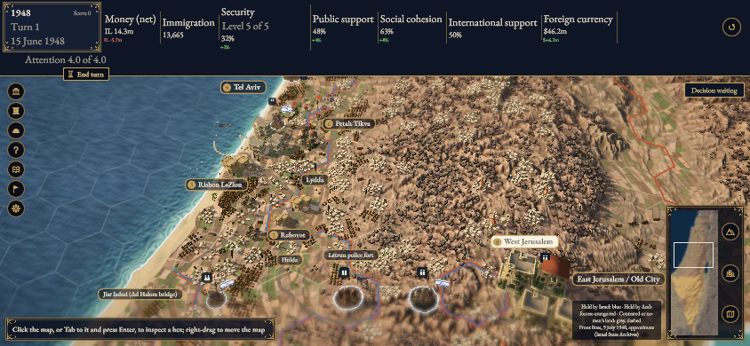
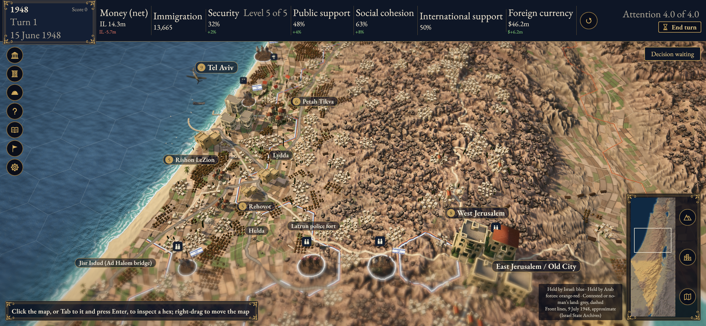
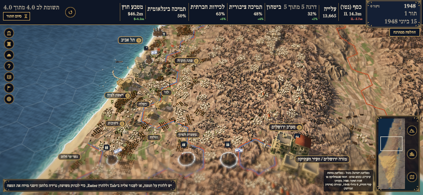
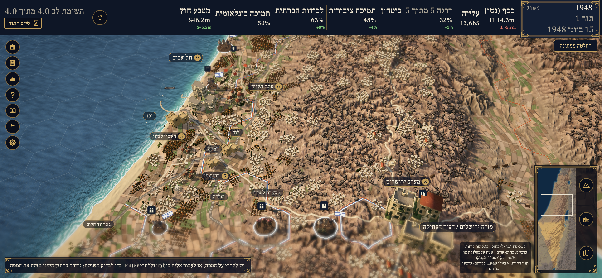

# Landscape HUD issue1088: original current-source captures

Source `79c6d1112ba15e2cb2292d2e217f70acdc307032`. The reported caption collision does not reproduce in these four Chrome views. No product patch was added for this investigation. Existing merged [PR #1013](https://github.com/eyalgolan/statecraft-israel/pull/1013) contains the intrinsic caption-fit calculation and landscape regression.

**Area to inspect:** the seven meter captions across the top bar, especially Money/Immigration, Security/Public support and International support/Foreign currency. All remain separately visible.

CSS viewport844×390; DPR 1 originals844×390; DPR 3 originals2532×1170. These are original unedited full frames. Identical seed 1948, turn 1/15 June1948, state hash, camera 90000/yaw 0; one ordinary Hide click. The EN DPR 1 layout uses two rows; the other three use one row of meters with stacked values/changes.

[Source, viewport, input and original hashes](provenance.json);[commands, results and scope](validation.txt). Native evidence is the focused import1/guard10/landscape1 probe and128 measured text bounds with0.5 CSS-pixel overlap tolerance, not a full native suite or raster-ink measurement.

Chrome for Testing 156.0.8078.4/macOS 27.0.1. Desktop DPR 3 is a proxy. Original v0.1.1 itch and real iPhone/Safari/physical input were not tested; no issue/release or human-review closure is asserted.

Real game captures include Copernicus DEM derived terrain/bakes and the game’s existing AI-made3D models. Attribution:Statecraft: Israel contributors; validation captures by Codex on the MacBook Pro. CC BY-SA4.0 under the existing engine-capture convention, pending owner verification. See [NOTICE](../../NOTICE) and [ASSETS.yaml](../../ASSETS.yaml). No new source/rights, native-language or personal-licence attestation.

| Language | DPR 1 | DPR 3 |
| --- | --- | --- |
| EN |  |  |
| HE |  |  |
