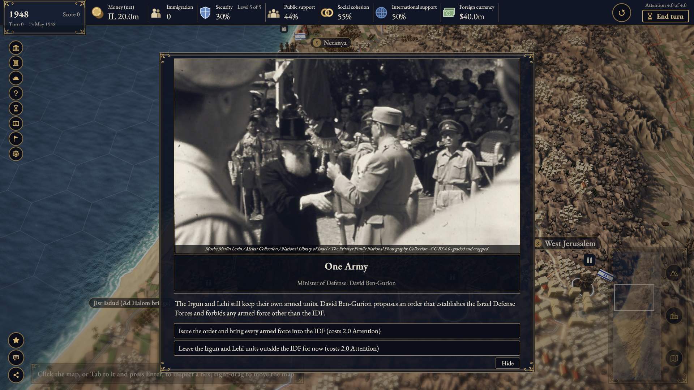
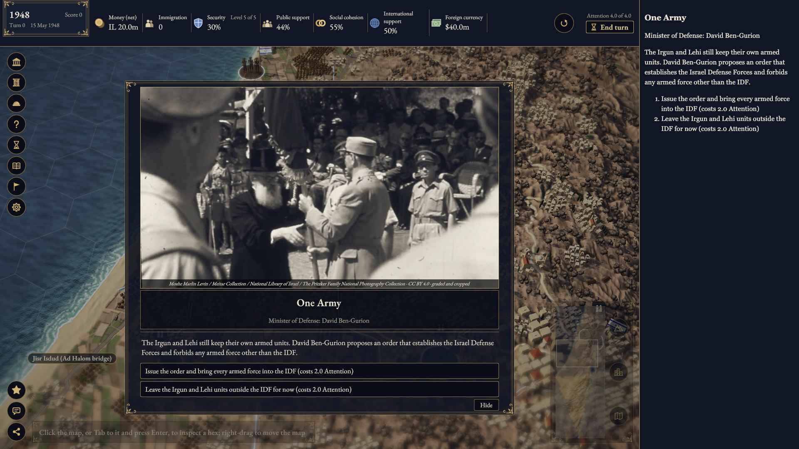
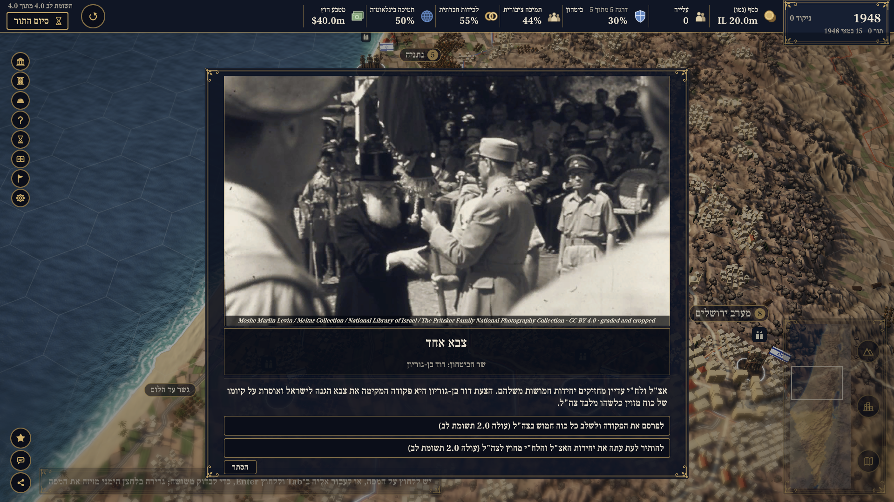
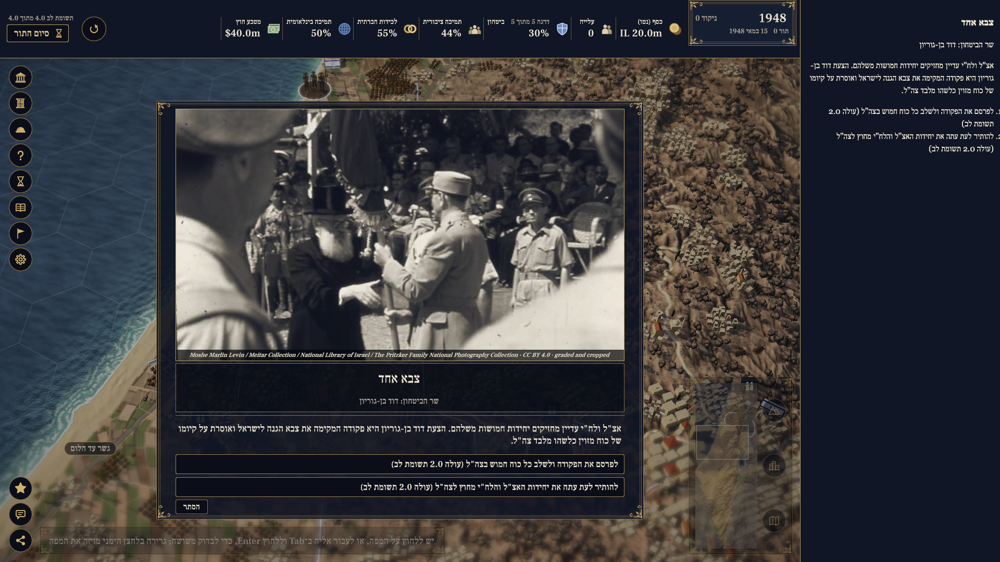
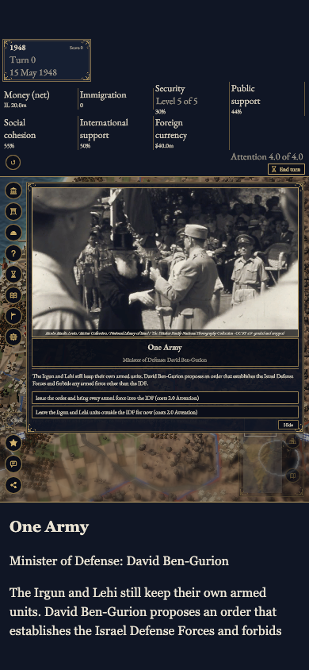
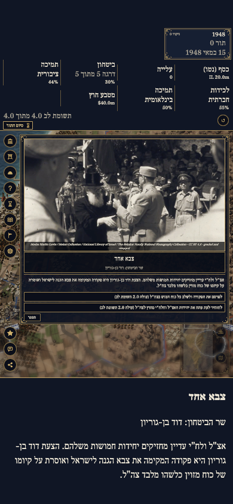

# #1119 B review checkpoint — 23 October 2026

Review evidence for [draft #1230](https://github.com/eyalgolan/statecraft-israel/pull/1230).
B is implemented. **Complete Native retry and corrected start-screen checks remain pending**
the coordinated machine window. This checkpoint is not a full-green or VoiceOver acceptance claim.
AI assistance: Codex implemented the feature and collected these technical records.

Runtime source: `4d681e5eaf6f648bab85fb37b9f1fe8b7ffca609`.
Baseline: `f9d8371d693c5996399c13fe5513bd225ec2f472`, a plain merge integrating main `a250e295`.
Later changes through validation head `6fe8dea9543fd7a515dc073a4737485e1c4bade1` are checker/test changes.
The audit-only product checkpoint is `0b41a3a313f5daf250c1c2a337af4a9c0547354d`.
Unity 6000.3.25f1; SDK 10.0.401; macOS 27.0.1 arm64; Chrome for Testing 156.0.8078.4; gzip.

- [Source and runtime audit](source-audit.json): template, all nine script `.jslib` files including ShareShot,
  eleven relevant C# files, compressed-runtime hashes and complete-player receipt hashes.
- [Base player receipt](base/player-receipt.json), [B player receipt](b/player-receipt.json): 113 files each.
- [Complete managed check](managed-final.log): 323 policy, 2,443 sim, 1,519 tools passed;
  five tools skips and two passing subtests; `ALL CHECKS PASSED`. The optional standalone
  Unity compile explicitly skipped because this clean checkout has no Library.
- [First full Native summary](validation-summary.json), [sanitized XML](full-editmode-sanitized.xml):
  2,356 total, 2,351 passed, one failed, four skipped; all four new payload methods passed.
  The failed existing `TheTemplateFillsTheWindowAndPersistsSaves` still demanded the old fixed
  full-window canvas. Its contract is updated for the approved separate game region; save/no-alert
  assertions remain. The full unfiltered rerun is pending. The original XML/log remain untouched
  locally; their SHA-256 hashes are in the summary. Public XML/logs remove environment identity and home/temporary paths and normalize
  trailing display whitespace; original raw files remain unchanged locally.
- The four Native skips are two Explicit capture/timing jobs and two optional-art comparisons
  without local sandbox/proto prefabs. No skip is waived or relabelled.
- [EN goldens/smoke5](b-golden-en.log), [HE goldens/smoke5](b-golden-he.log),
  [EN orders](b-orders-en.log), [HE orders](b-orders-he.log): all nine exact manifest values and both
  browser smoke paths pass without re-recording any reference.
- [B ordinary-input observations](b/observations.json): new game through `firstcard`, the actual event,
  a real insufficient-Attention budget refusal, and End Turn, in EN/HE. No sim command/state injection.
- [First start-screen run](b-start-en.log): preserved failure from the old fixed End Turn point after
  the narrowed canvas re-tiers the HUD. The checker now follows mirrored focus with normal Tab/Enter;
  [67 focused checks passed](canvas-focus-green.log), but the actual start-screen rerun is pending.
- [Old click-mapping negative control](canvas-click-identity-red.log): resized/inset cases fail,
  full-window case passes. [Old SafeArea negative control](safe-area-red.log) has the same 2-fail/1-pass split.
  [Missing renderer negative control](base-dom-red.log) and passing DOM/bridge runs are also retained.
- [Base boot](base-boot.log), [B boot](b-boot.log): three cold profiles, CPU 4, exclusive machine lock.
  Map medians 4,282 → 4,610 ms; first-frame medians 15,454 → 17,703 ms.
  Both pass the existing default growth budget max(300 ms, 50%).
- [File hashes](manifest.json) cover the public review files. These are review artifacts, outside
  the product PR diff and Unity imports; no new shipped font/image/library is introduced.

## Matched desktop captures

`firstcard`, 15 May 1948, turn 0, opening camera, One Army card. Same 1920×1080 viewport,
language and game state per pair. The canvas resize is intentional: the game and companion
occupy separate regions. The map/HUD/card scale is shown as a side effect.

| Language | Base | B |
| --- | --- | --- |
| EN |  |  |
| HE |  |  |

## B phone layout and later steps

Phone captures are emulated 390×844, with a CDP safe-area override of 47px top and 34px bottom;
they are not a real-device test. These B-only images show a separately scrolling panel below
the inset canvas. Matching inset baseline phone captures are still pending.

| EN phone | HE phone |
| --- | --- |
|  |  |

[EN refusal](b/en-1920x1080-refusal.png), [HE refusal](b/he-1920x1080-refusal.png),
[EN result](b/en-1920x1080-result.png), [HE result](b/he-1920x1080-result.png).
Existing game image attributions remain visible in the captures and recorded in the repository's asset ledger.

The contributor will manually run VoiceOver with its caption panel in fresh EN/HE profiles.
No speech/caption evidence is supplied by these DOM, keyboard or screenshot records.
C needs a later owner decision. Keep the PR draft and personal AI/licence boxes unticked.
