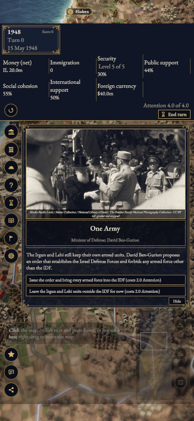
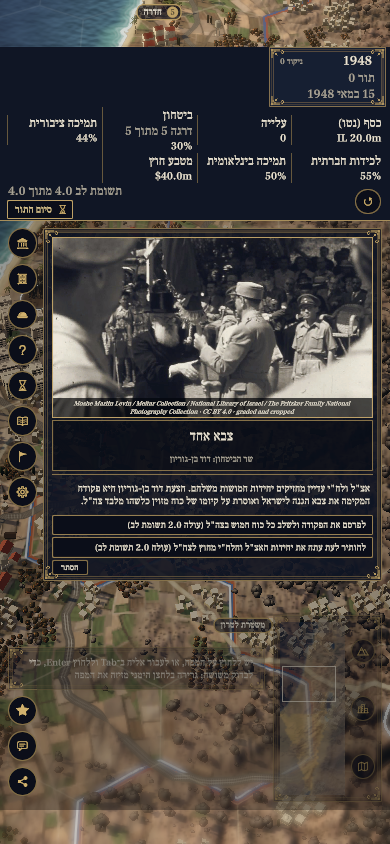

# #1119 B review evidence — 23 October 2026

Technical evidence for [draft #1230](https://github.com/eyalgolan/statecraft-israel/pull/1230).
The local technical reruns are complete. **Real VoiceOver acceptance remains pending**;
C needs a later owner decision. The PR stays draft, with both personal attestations left to the contributor.
AI assistance: Codex implemented B and collected these technical records.

Product checkpoint: `3531bad9` (code plus final audit/docs).
Tested runtime: `aaa44832bf725afff012d1cf30eb3e06e732d3b2`.
Baseline: `f9d8371d693c5996399c13fe5513bd225ec2f472`, a plain merge of main `a250e295`.
Unity 6000.3.25f1; SDK 10.0.401; macOS 27.0.1 arm64; Chrome for Testing 156.0.8078.4; gzip.
#1227 remains maintainer-owned and open; main must be merged again after it lands, with affected gates repeated.

## Source and test records

- [Source/runtime audit](source-audit.json): 21 relevant source hashes, all nine script `.jslib` bridges
  including ShareShot, DLL hashes, build sizes, timings and test source pins.
- [Base receipt](base/player-receipt.json), [final B receipt](b/player-receipt.json): all 113 files each.
  [Generated build-settings hashes](b/build-settings-receipt.json) record Unity's automatic serialization;
  those settings changes were restored and never committed as product changes.
- [Full managed check](managed-final.log), source `9fb249c8`: 323 policy, 2,443 sim and 1,525 tools passed,
  five tools skips and two passing subtests. Optional standalone Unity compile explicitly skipped because
  the separate clean checkout has no Library. The final two HTML attributes/headed condition are covered
  by [91 final focused checks](phone-layout-green.log) at `aaa44832` and the actual headed run.
- [Validation summary](validation-summary.json), [full Native retry XML](full-editmode-final-sanitized.xml):
  `0b41a3a3`, unfiltered, 2,356 total, 2,352 passed, zero failed, four skipped. All four companion payload
  methods passed. The [C# scope check](native-source-scope.json) verifies that subsequent C# changes are
  comment-only; sim/content are unchanged. [Final Native template contract](native-template-final-sanitized.xml)
  at `aaa44832`: six passed, zero failed/skipped. All have zero CS warnings/errors.
- The four full Native skips are two Explicit capture/timing jobs and two optional-art comparisons without
  local prefabs. None is waived or relabelled. The [first full Native XML](full-editmode-sanitized.xml) retains
  the one old fixed-canvas contract failure; its corrected game-region contract keeps save/no-alert assertions.
  Raw originals remain untouched locally, with hashes in the summary. Public XML/logs remove environment,
  home and temporary-path identity, redact the domain-reload test correlation token, and normalize trailing display whitespace.
- [EN goldens/smoke5](b-golden-en.log), [HE goldens/smoke5](b-golden-he.log), [EN orders](b-orders-en.log),
  [HE orders](b-orders-he.log), [EN New Game/End Turn](b-start-en.log), [HE New Game/End Turn](b-start-he.log):
  all nine exact manifest values and the ordinary start-screen paths pass on the final player.
  No golden/reference was re-recorded. The [original fixed-coordinate timeout](historical-b-start-en.log)
  is preserved separately; the corrected checker follows ordinary Tab/Enter through mirrored focus.
- [Actual headed observations](b/observations.json), [headed result](b-flow.log): desktop new game, event,
  real insufficient-Attention budget refusal and End Turn in EN/HE; phones 390×844 and 375×667 also test
  scroll reach, click in an overflowing panel, the next Tab and subsequent event/End Turn keys.
  DOM focus may remain on the clicked container while game keyboard play works. No sim state/command injection.
- [Phone negative controls](phone-layout-red.log), [scrolled-inset negative control](phone-safe-area-red.log):
  the old layout fails three phone geometries and the old bridge adds 80px top padding after scrolling.
  [Final checks](phone-layout-green.log) pass. [Synthetic Chrome Tab reproduction](phone-focus-before.log)
  and [approved negative-tabindex candidate](phone-focus-candidate.log) are separate from actual-game evidence.
- Historical Native negative-control links contain structured XML case results and original log hashes; full Editor startup/licensing logs stay local. Earlier [missing payload](payload-red.log), [unsettled visibility](settle-red.log), [missing renderer](base-dom-red.log),
  [canvas mapping](canvas-click-identity-red.log) and [inset handling](safe-area-red.log) failures remain reviewable.

## Interleaved boot

Requested base, B, base, B order; each block `--runs 3 --cpu 4`, exclusive lock, no Unity/SDK,
and other-task source copying finished before timing. [All samples and budget checks](interleaved-boot.json).

| Block | Player | Map median, ms | First-frame median, ms |
| --- | --- | ---: | ---: |
| [1](b-boot-1-base.log) | Base | 4,344 | 16,043 |
| [2](b-boot-2-b.log) | B | 4,216 | 15,297 |
| [3](b-boot-3-base.log) | Base | 4,160 | 15,184 |
| [4](b-boot-4-b.log) | B | 4,217 | 15,331 |

The old +2,249ms first-frame gap did not recur: paired differences −746ms and +147ms;
pooled six-run medians 15,229 → 15,314ms (+85ms). Map medians 4,198.5 → 4,216.5ms.
Both pairs pass the repository's existing max(300ms, 50%) budget. This assigns no cause to the earlier gap;
the collector's scheduler was kept. [Earlier base](base-original-boot.log) and [earlier B](historical-b-boot.log)
remain historical measurements of the earlier player. Final gzip bytes: data 25,695,678; wasm 14,343,739;
framework.js 97,863 (base: 25,696,308 / 14,343,950 / 97,719).

## Matched captures

`firstcard`, 15 May 1948, turn 0, opening camera and One Army card; matching visible opening state, viewport and language per pair. Each profile starts an ordinary New Game; the fresh RNG seed/state hashes differ and are retained in the console records.
The separate companion intentionally reduces the canvas and rescales the existing map/HUD/card.
Phone captures use emulated 390×844 with actual CDP 47px top / 34px bottom safe insets; no real-device claim.

| Layout | Base | Final B |
| --- | --- | --- |
| EN desktop |  |  |
| HE desktop |  |  |
| EN phone |  |  |
| HE phone |  |  |

The corrected phone canvas is 390×585, preserving the existing portrait HUD arrangement.
At 375×667 it is 375×538; [EN scrolled](b/en-375x667-scrolled.png) and [HE scrolled](b/he-375x667-scrolled.png)
show the reachable panel inside the fixed safe edges. [Earlier B receipt/captures](historical-b/player-receipt.json)
retain the cramped first phone layout separately. [EN refusal](b/en-1920x1080-refusal.png),
[HE refusal](b/he-1920x1080-refusal.png), [EN result](b/en-1920x1080-result.png), [HE result](b/he-1920x1080-result.png).
Existing image attributions remain visible and recorded in the repository asset ledger.

[Capture provenance](../../ASSETS.yaml) is recorded only on this evidence branch. [Manifest](manifest.json) hashes every public review file. These records are on a separate evidence branch;
no review binary is shipped in the product PR. The contributor will manually collect fresh EN/HE VoiceOver
caption-panel output, recording build, macOS/browser/VoiceOver versions, silence and unreachable controls.
No speech or caption evidence is supplied by these browser/DOM records. Personal AI/licence boxes are untouched.
