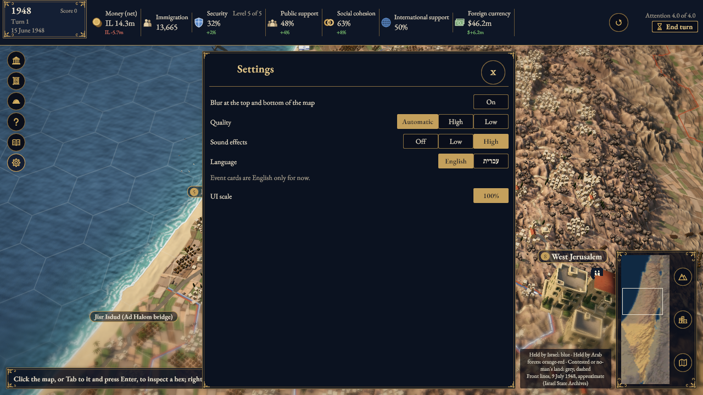
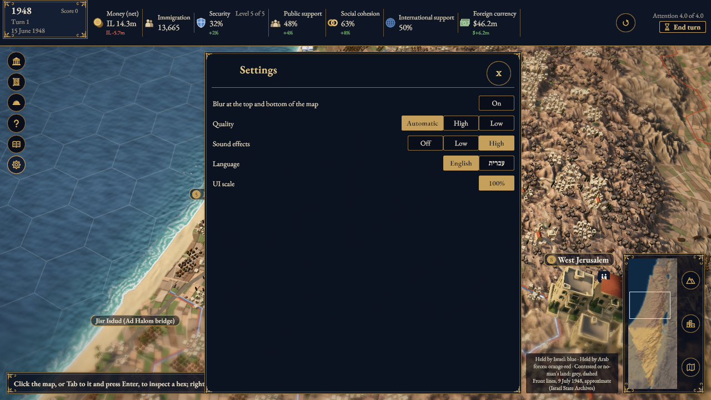
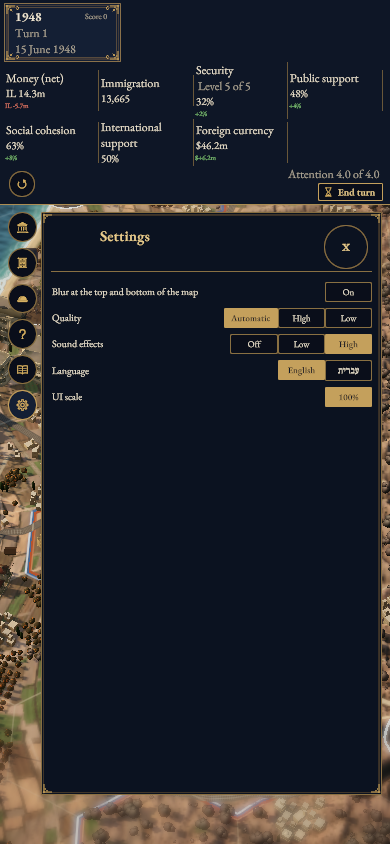
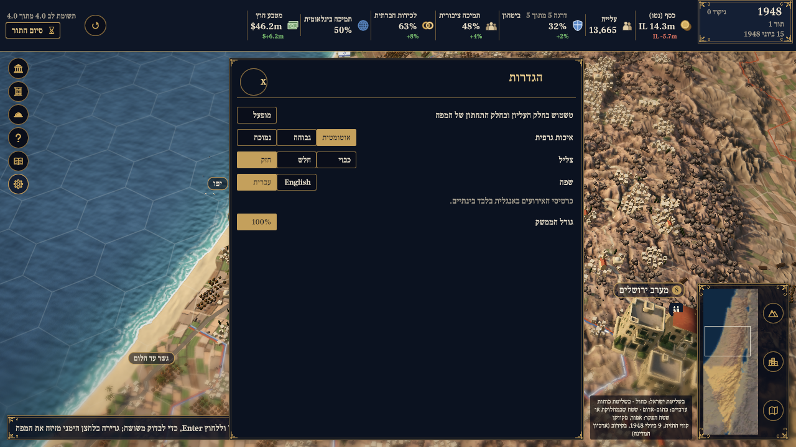
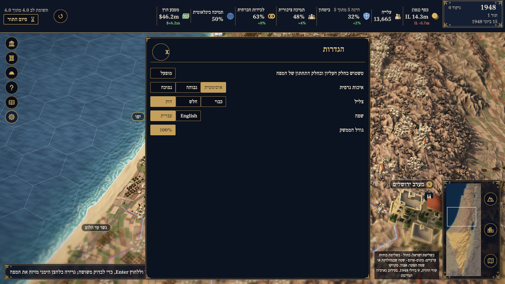
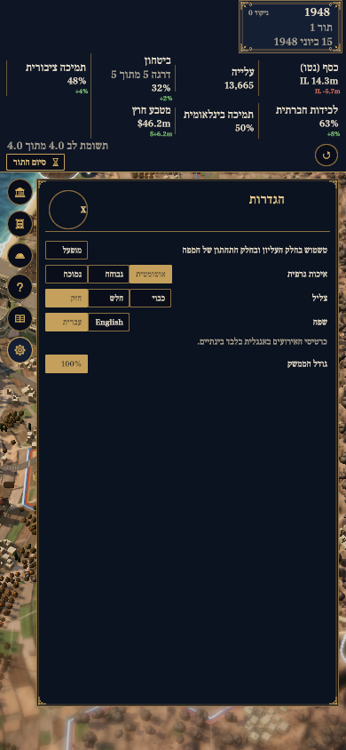
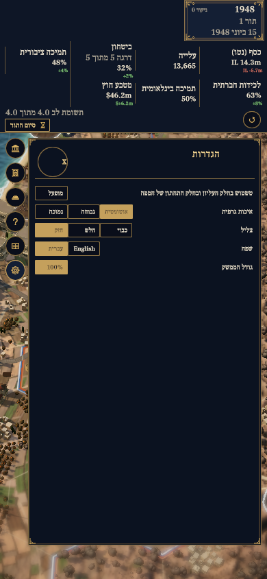

# Settings issue1191: matched original captures

BEFORE `107a45bb8a0c3223d78cfa5a57abaa1cfde1b3e7`; AFTER `98b4f9c434dbf7651006e0f40fdc6fdb5c66f989`. These screenshots validate these frozen sources; they do not establish current-main or merge readiness.

**Changed area:** the obsolete English-only event-card notice beneath the language buttons is visible BEFORE and removed AFTER. Both language choices, sound High, Automatic quality and 100% scale remain visible at both sizes.

All images are original unedited game PNGs. DPR1; deterministic bootstrap seed1948;15 June1948/turn1; identical state hash; camera90000/yaw0; fresh Auto profile; adaptive fallback disabled. Only two ordinary clicks after bootstrap: Hide the pending event, then open Settings. See [provenance](provenance.json) for hashes and exact inputs.

Agent visual inspection only. No native-speaker, rights or personal-licence attestation. Existing human and release gates remain unchanged. Captures include Copernicus DEM derived map/bakes and the game’s existing AI-made 3D models; see the project [NOTICE](../../NOTICE) and [ASSETS.yaml](../../ASSETS.yaml). Capture attribution: Statecraft: Israel contributors; validation capture by Codex on the MacBook Pro. CC BY-SA4.0 under the existing engine-capture convention, pending owner verification.

## EN 1280×720

| BEFORE: notice visible | AFTER: notice removed |
| --- | --- |
|  |  |

## EN 390×844

| BEFORE: notice visible | AFTER: notice removed |
| --- | --- |
|  |  |

## HE 1280×720

| BEFORE: notice visible | AFTER: notice removed |
| --- | --- |
|  |  |

## HE 390×844

| BEFORE: notice visible | AFTER: notice removed |
| --- | --- |
|  |  |
