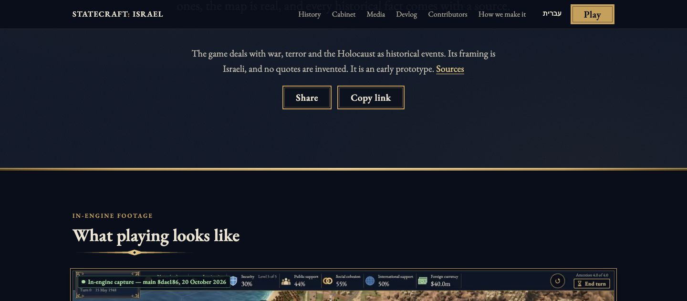
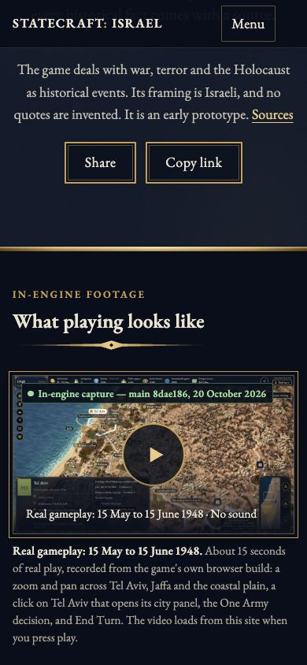
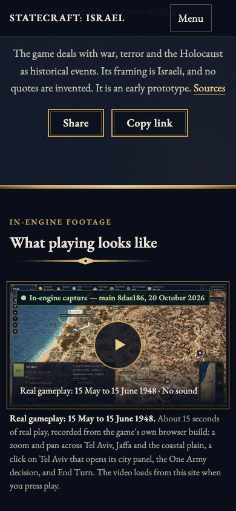
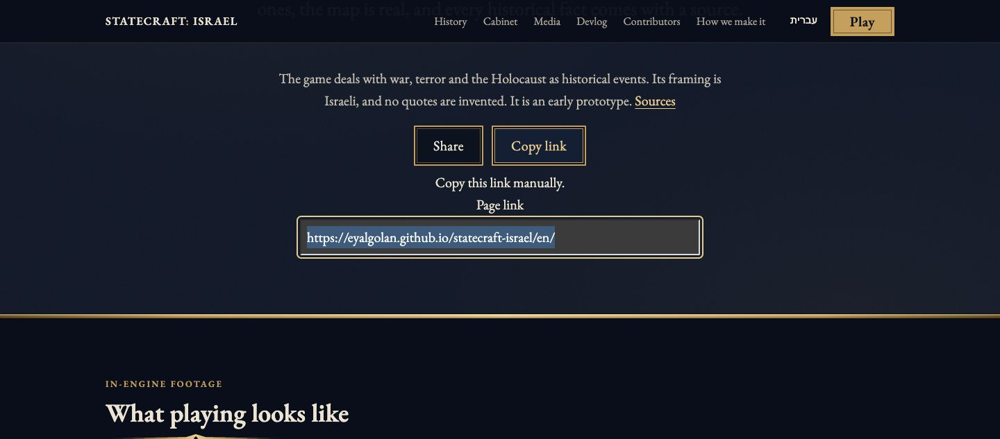
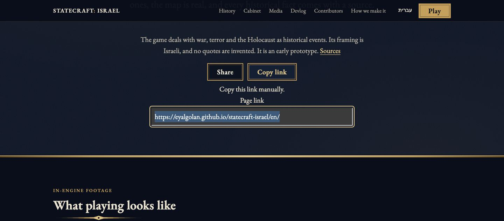
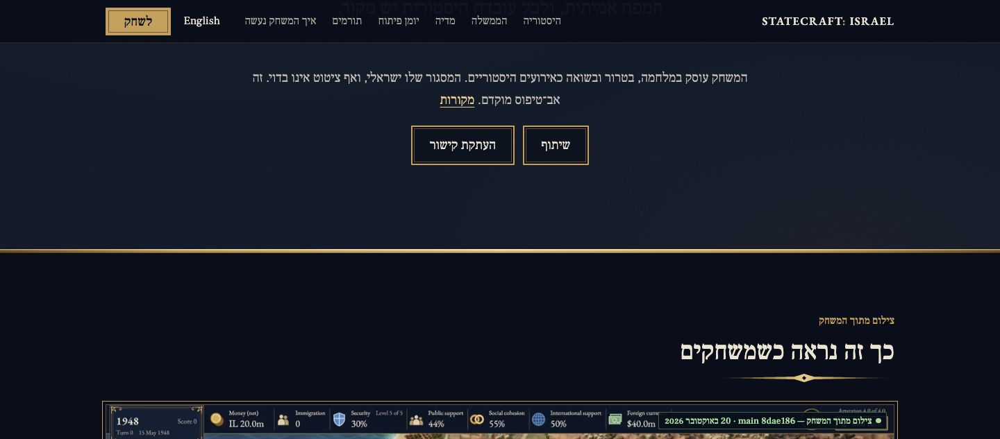
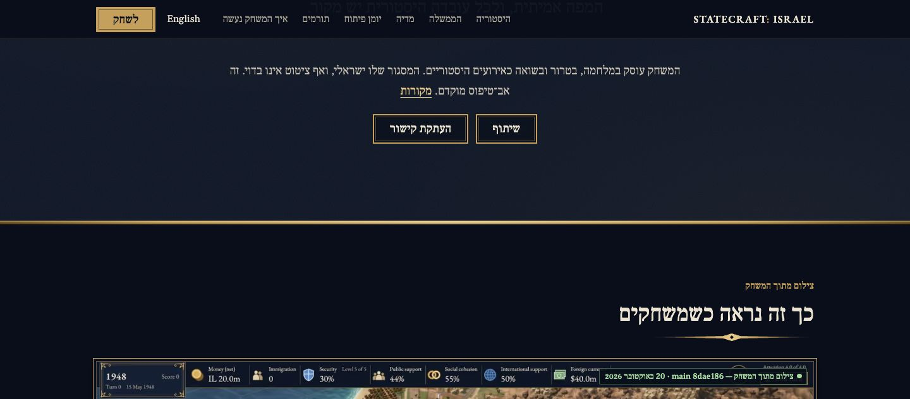
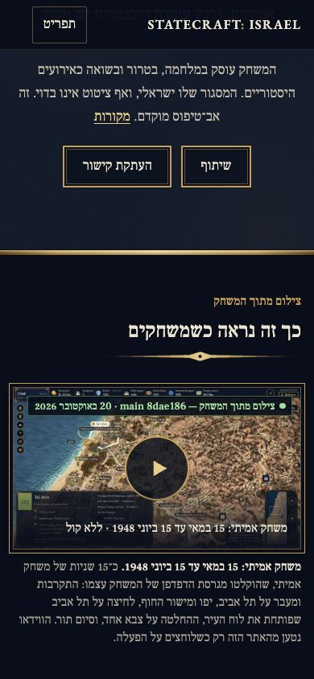
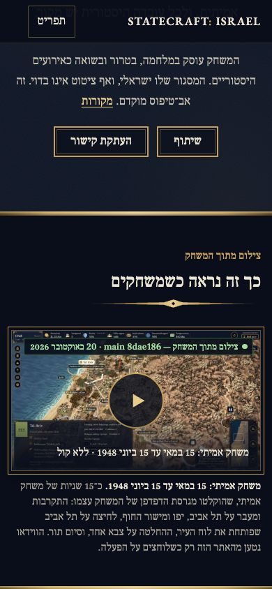
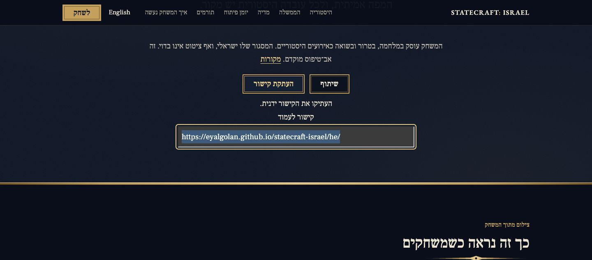

# Sharing controls: final typography review for PR #1348

These twelve original, unedited JPEGs compare **BEFORE `6e1527c465b702062898d8f3547c11e0e8c56f6a`** with **AFTER `a58febaa77effeddd8b2ca6e719f9fce2af60ea9`**, tree `ed3b6ac082ff28b00536886de8dc6e87ac8ed277`. The before build already contains the centering correction and approved Test step. The final correction inherits only font family and size, retaining the site's `.btn` weight **600**, line-height **1.2** and pointer cursor. The after head also merges upstream main `8c126f2b485b7fd1bd7fc722cb33eca0381c8a5e`; these are pinned build comparisons, not a claim that the entire repository difference is one CSS line.

Actual macOS Google Chrome 155.0.8059.85 ran headless in dedicated contexts, DPR 1. Before each capture, the sharing component's top settled at **y = 180 ± 1 CSS px**. Every pair uses the same viewport. Images are original quality-80 JPEGs with no crop, retouch, composition or redaction. The corrected buttons are shorter; the following content moves naturally.

| Case | BEFORE 6e | AFTER a58 |
|---|---|---|
| EN desktop 1440 × 633 |  |  |
| EN mobile 390 × 844 |  |  |
| EN desktop real refusal / manual URL |  |  |
| HE desktop 1440 × 633 |  |  |
| HE mobile 390 × 844 |  |  |
| HE desktop real refusal / manual URL |  |  |

Six real computed-style cases on 6e produced **24 font failures and 86 existing assertions passing**. The same expanded checks on final a58 pass **110/110**, with zero page errors. They read actual `fontWeight` and `lineHeight`; they do not copy stylesheet text or override the DOM, CSS or browser APIs. Fractional line-height serialization permits 0.01 CSS px only.

Four separate actual clipboard checks passed on each head: English/Hebrew at desktop/mobile sizes, replacing a public seeded marker with the exact rendered canonical and excluding query/fragment data. The default screenshots precede those copy controls. Desktop manual cases use a real HTTP `Permissions-Policy: clipboard-write=()` response and actual Copy button action; no mock API is used. No native Share chooser was opened, and no private clipboard is shown.

Final a58 local checks passed: 15 Node tests; 320 policy tests; 2,408 simulation tests; 1,507 tools tests with 5 skips and 2 subtests; both root/project Astro builds with 420 output files and 28 checked pages each. The explicit golden-update simulation run passed all 2,408 tests; no golden moved. All 3,114 tracked source files and ten golden/constant files were unchanged through these gates. The Unity .NET compile explicitly skipped because this site-only checkout has no Library; Native/EditMode/WebGL is not claimed. Exact commands, output excerpts, timings and source attribution are in [validation.txt](validation.txt), with image hashes and measured assertions in [provenance.json](provenance.json).

This is an **evidence-only fork branch**; do not merge it into the product PR. The [older dd3d gallery](https://github.com/avlco/statecraft-israel/blob/dd3d17d6888f17046a8191639abb18bdd9ae15cb/docs/review-1038/README.md) records 9587. The [054b gallery](https://github.com/avlco/statecraft-israel/blob/054b27840747b952f5f2c1626d7fcb364d387130/docs/review-1348-ui-b4fc/README.md) records the earlier centering fix at B4FC, whose buttons still used the broad font shorthand. Those galleries and the local 8c981 trial remain historical. Initial unstable framing trials are excluded, rather than relabelled as final a58 images.

Browser viewports are not physical-device QA. Hebrew remains agent-checked and awaits a native speaker's review (#564). Local checks do not attest current GitHub CI or deployment. This gallery supplies no personal licence statement or new rights/release approval.

## Credit and licence

Credit **Statecraft: Israel contributors**; original validation captures by **Codex on the MacBook Air**. Screenshot licence: **CC BY-SA 4.0**, status **owner-verify**, following the most restrictive visible existing map-poster input. Website text is CC BY 4.0. EB Garamond and Frank Ruhl Libre retain the OFL notices in `site/public/fonts/`.

The existing gameplay poster below the controls is `docs/images/build-m3-city.jpg`, main 8dae186 (20 October 2026), CC BY-SA 4.0 under its specific ASSETS row. It includes existing Copernicus-derived terrain and Tal Heuberger's AI-generated Tripo models, The 1948 Collection. These are website captures, not a new gameplay recording or historical assertion.

Required terrain notice: produced using Copernicus WorldDEM-30 (c) DLR e.V. 2010-2014 and (c) Airbus Defence and Space GmbH 2014-2018 provided under COPERNICUS by the European Union and ESA; all rights reserved.

See the pinned ASSETS.yaml, LICENSING.md and NOTICE. A broad older licensing row says CC BY 4.0, but the specific build-capture row states CC BY-SA 4.0; this proposal preserves the more restrictive input without changing licensing policy.
