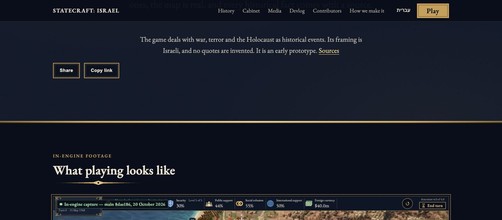
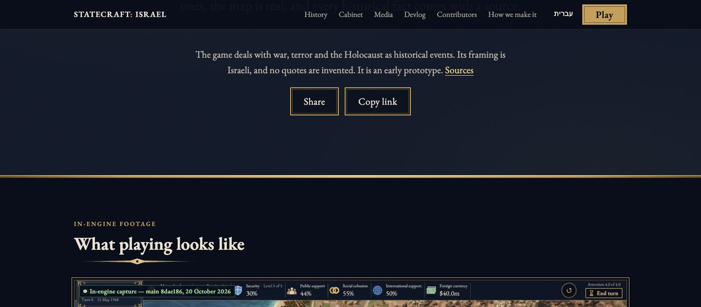
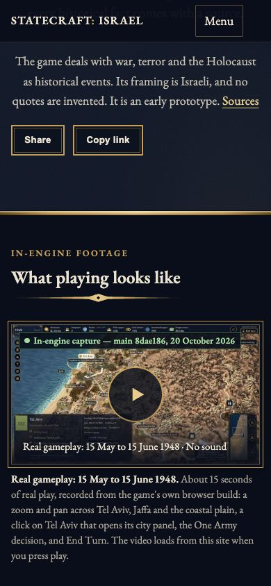
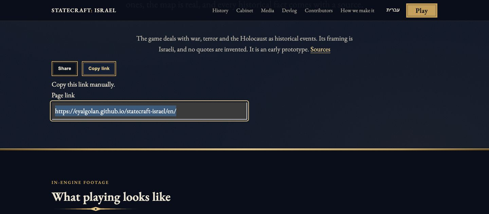
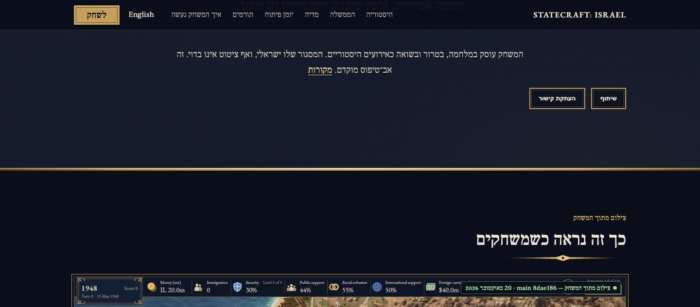
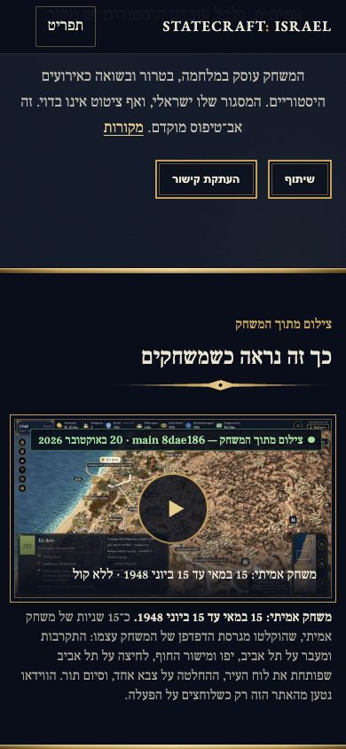
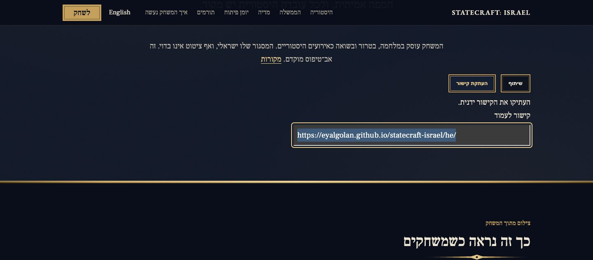
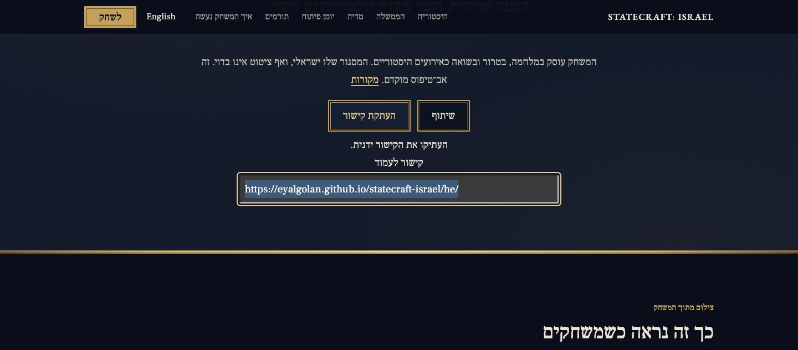

# Sharing controls: UI review of B4FC (#1348)

These are twelve original unedited browser-content JPEGs from two local normal Astro builds: **before 2ebbc7156102e49b89a8c47d796e91197b91d5c2**, **after b4fc8f20e41ad09d1888328c426ef18a0cd4bb24** (tree 9fae27117be2cda51673fa9d65c56907311e11e2). AFTER also incorporates newer upstream changes; these are pinned build comparisons, not a claim that their whole-tree difference is CSS alone.

The changed area is Share / Copy link beneath Sources: inherited site font and size, pointer affordance, centered controls/status/manual URL in both language directions. Each capture waited for the sharing component top to reach y=180 within 1 CSS px. Same viewport and DPR 1 in every pair; the corrected controls occupy more vertical space. JPEG quality 80, no crop, retouch, redaction, composition or AI-generated pixels. The six initial unstable framing trials are excluded.

| Case | BEFORE | AFTER |
|---|---|---|
| EN 1440 × 633 default |  |  |
| EN 390 × 844 default |  |  |
| EN 1440 × 633 real policy denial / manual URL |  |  |
| HE 1440 × 633 default |  |  |
| HE 390 × 844 default |  |  |
| HE 1440 × 633 real policy denial / manual URL |  |  |

Actual Google Chrome 155.0.8059.85 ran headless on macOS. The six BEFORE cases produced 56 expected style assertion failures out of 86 assertions; the six AFTER cases passed all 86. Page errors: zero in each run. The desktop manual paths used the real HTTP `Permissions-Policy: clipboard-write=()` response header and actual button action, with no API mock. Four separate AFTER Copy checks (EN/HE, desktop/mobile) changed an isolated browser clipboard from a public test marker to the rendered public canonical URL, excluding query and fragment. The screenshots precede those four copy actions; they are visual evidence, not pictures of a native chooser or private clipboard. Native Share API availability was observed; its chooser was not exercised.

Each build contains 420 output files. Exact source/build manifest hashes, timestamps, image hashes and sanitized measured assertions are in [provenance.json](provenance.json); commands/results and limits are in [validation.txt](validation.txt). These checks do not attest CI, deployed behavior, all-browser or physical-device acceptance. Hebrew remains agent-checked, pending native human review (#564). No personal licence checkbox is supplied.

This is an **evidence-only fork branch**. Do not merge it into the product PR. The [older 9587 gallery](https://github.com/avlco/statecraft-israel/blob/dd3d17d6888f17046a8191639abb18bdd9ae15cb/docs/review-1038/README.md) remains historical evidence of a different head; it must not be relabelled B4FC. This new gallery addresses the later UI review. No GitHub attachment upload is claimed.

## Credit and licence

Credit **Statecraft: Israel contributors**; original validation captures by **Codex on the MacBook Air**. Proposed screenshot licence: **CC BY-SA 4.0**, following the most restrictive visible existing map-poster input. Status remains **owner-verify**; this adds no rights or release attestation. Website text is CC BY 4.0. EB Garamond and Frank Ruhl Libre are covered by their OFL notices in `site/public/fonts/`.

The existing gameplay poster visible below the controls is `docs/images/build-m3-city.jpg`, main 8dae186 (20 October 2026), under its CC BY-SA 4.0 ASSETS row. It shows the existing Copernicus-derived terrain and Tal Heuberger's AI-generated Tripo models (The 1948 Collection). This gallery creates no new gameplay recording, historical claim or AI image.

Required terrain notice: produced using Copernicus WorldDEM-30 (c) DLR e.V. 2010-2014 and (c) Airbus Defence and Space GmbH 2014-2018 provided under COPERNICUS by the European Union and ESA; all rights reserved.

See the pinned repository ASSETS.yaml, LICENSING.md and NOTICE for original input records. A broad older LICENSING captures row says CC BY 4.0, while the specific current `docs/images/build-*.jpg` row states CC BY-SA 4.0; this proposal retains the specific, more restrictive row and does not rewrite licensing policy.
